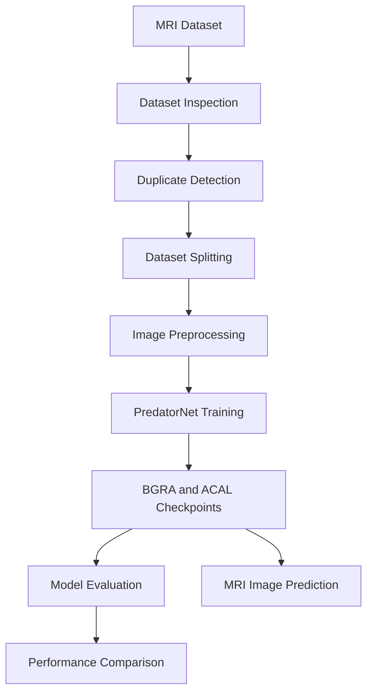
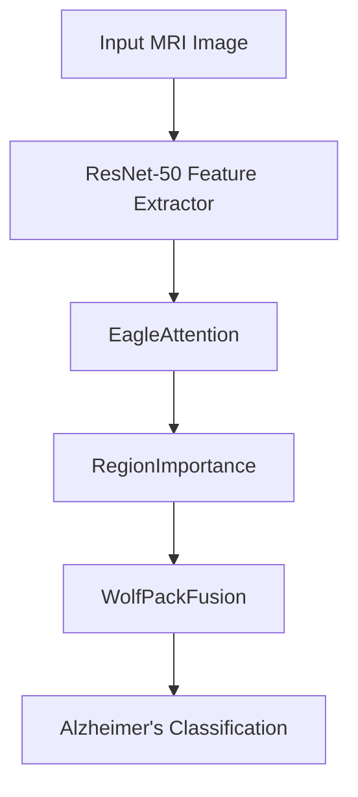
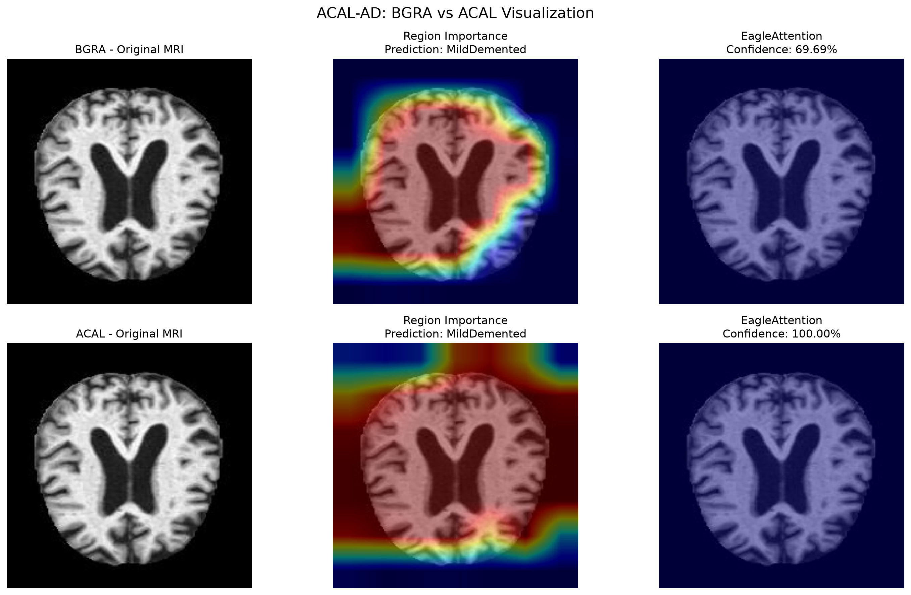

# ACAL-AD

## Adaptive Confusion-Aware Loss for Alzheimer's Disease Classification Using MRI Images

## 1. Project Overview

ACAL-AD is a deep learning research project designed to classify Alzheimer's disease stages from brain MRI images using a four-class classification approach.

The project introduces **Adaptive Confusion-Aware Loss (ACAL)**, which uses training confusion statistics to adaptively penalize classification errors between different disease classes.

The project compares two approaches:

1. **BGRA (Baseline):** Combines Cross-Entropy Loss and Region Total Variation Smoothness Loss.
2. **ACAL (Proposed):** Combines Cross-Entropy Loss, Region Total Variation Smoothness Loss, and an adaptive confusion penalty.

The project uses a custom **PredatorNet** architecture based on ResNet-50.

## 2. Project Objectives

- Develop a deep learning model for four-class Alzheimer's disease classification.
- Implement the PredatorNet architecture.
- Develop an Adaptive Confusion-Aware Loss function.
- Compare the proposed ACAL approach against the BGRA baseline.
- Evaluate model performance across different random seeds.
- Generate classification reports, confusion matrices, and ROC curves.
- Maintain research reproducibility and perform data leakage checks.\

### Project Workflow



## 3. Dataset Information

**Dataset:** Augmented Alzheimer MRI Dataset

**Kaggle source:**  
https://www.kaggle.com/datasets/uraninjo/augmented-alzheimer-mri-dataset

The project maintains original and augmented images separately. The original-only workflow uses 6,400 MRI images for dataset inspection, preparation, and evaluation experiments.

### Original Dataset Distribution

| Class | Number of Images |
|---|---:|
| MildDemented | 896 |
| ModerateDemented | 64 |
| NonDemented | 3,200 |
| VeryMildDemented | 2,240 |
| **Total** | **6,400** |

### Classification Categories

| Class | Description |
|---|---|
| MildDemented | Mild dementia |
| ModerateDemented | Moderate dementia |
| NonDemented | No dementia |
| VeryMildDemented | Very mild dementia |

### Dataset Split

A reconstructed 80:10:10 split is available for exploratory evaluation.

Its exact membership has not been verified against the original training split used to produce the existing checkpoints. Therefore, independent test-set performance cannot be guaranteed.

## 4. Model Architecture

The project uses **PredatorNet**, a custom deep learning architecture built on a ResNet-50 backbone for four-class Alzheimer's MRI classification.

### Main Components

**1. ResNet-50 Backbone**
- Extracts deep feature representations from MRI images.
- Produces high-level spatial feature maps.

**2. EagleAttention**
- Applies spatial self-attention to the extracted feature maps.
- Uses Query, Key, and Value projections.
- Includes a learnable residual scaling parameter (`gamma`).

**3. RegionImportance**
- Generates a spatial importance map using sigmoid activation.
- Uses the map to weight the extracted feature activations.

**4. WolfPackFusion**
- Contains three independent classification branches.
- Combines their outputs through average-logit fusion.

**Final Outputs:**
- Four-class classification logits.
- Region importance map.
- Spatial attention map.

### Architecture Diagram



### Model Visualization

The following visualization compares the BGRA baseline and proposed ACAL model, showing the original MRI image, Region Importance maps, and EagleAttention maps.



## 5. Loss Functions

### BGRA Baseline Loss

The baseline loss combines:

- Cross-Entropy Loss
- Region Total Variation Smoothness Loss

**Formula:**

\[
L_{BGRA}=L_{CE}+0.01L_{TV}
\]

### Proposed ACAL Loss

The proposed loss combines:

- Cross-Entropy Loss
- Region Total Variation Smoothness Loss
- Adaptive Confusion Penalty

**Formula:**

\[
L_{ACAL}=L_{CE}+0.01L_{TV}+0.10L_{Confusion}
\]

### Adaptive Confusion Configuration

The confusion statistics are updated using training predictions only.

The adaptive confusion weights use:

- Exponential Moving Average (EMA): 0.90
- Laplace smoothing: 1
- Zero diagonal confusion penalty

Validation and test data must not update the confusion statistics.

## 6. Project Structure
```text
ACAL-AD/
│
├── assets/
│   └── acal-ad-visualization.png
│
├── configs/
│   └── config.yaml
│
├── models/
│   ├── PredatorNet_ACAL_Seed123.pt
│   ├── PredatorNet_ACAL_Seed42.pt
│   ├── PredatorNet_BGRA_Seed123.pt
│   └── PredatorNet_BGRA_Seed42.pt
│
├── notebooks/
│   └── predatornet_training.ipynb
│
├── scripts/
│   ├── analyze_duplicates.py
│   ├── check_environment.py
│   ├── compare_experiments.py
│   ├── detect_near_duplicates.py
│   ├── evaluate_checkpoints.py
│   ├── evaluate_reconstructed_split.py
│   ├── inspect_dataset.py
│   ├── predict_image.py
│   ├── prepare_dataset.py
│   ├── reconstruct_split.py
│   ├── review_near_duplicates.py
│   ├── verify_checkpoints.py
│   └── visualize_prediction.py
│
├── src/
│   ├── data/
│   │   ├── dataloader.py
│   │   ├── dataset.py
│   │   └── preprocessing.py
│   ├── evaluation/
│   │   ├── confusion_matrix.py
│   │   ├── metrics.py
│   │   └── visualization.py
│   ├── losses/
│   │   └── losses.py
│   ├── models/
│   │   └── predatornet.py
│   ├── utils/
│   ├── checkpoint_utils.py
│   ├── config.py
│   ├── data_audit.py
│   ├── preprocessing.py
│   └── splitting.py
│
├── tests/
│   ├── test_config.py
│   ├── test_data_audit.py
│   ├── test_preprocessing.py
│   └── test_splitting.py
│
├── .gitattributes
├── .gitignore
├── README.md
├── __init__.py
├── requirements.txt
└── requirements-dev.txt
```
## 7. Technology Stack

| Category | Technologies |
|---|---|
| Programming Language | Python |
| Deep Learning | PyTorch |
| Computer Vision | Torchvision, OpenCV, Pillow |
| Data Processing | NumPy, Pandas, SciPy |
| Machine Learning | Scikit-learn |
| Visualization | Matplotlib, Seaborn |
| Configuration | YAML |
| Progress Tracking | TensorBoard |
| Experiment Environment | Kaggle Notebook |
| Testing | Pytest |

## 8. Installation and Setup

### Prerequisites

Install the following:

- Python 3.10 or a compatible Python version
- Git (optional)
- Visual Studio Code or another Python editor
- Jupyter Notebook support

### Step 1: Extract the Project

Extract the project ZIP file and open PowerShell inside the project directory.

### Step 2: Create a Virtual Environment

```powershell
python -m venv .venv
```

### Step 3: Activate the Environment

For Windows PowerShell:

```powershell
.\.venv\Scripts\Activate.ps1
```

If PowerShell blocks script execution:

```powershell
Set-ExecutionPolicy -Scope Process -ExecutionPolicy Bypass
.\.venv\Scripts\Activate.ps1
```

### Step 4: Upgrade pip

```powershell
python -m pip install --upgrade pip
```

### Step 5: Install Dependencies

```powershell
pip install -r requirements-dev.txt
```

For GPU training, install a PyTorch build compatible with the available CUDA environment using the official instructions:

https://pytorch.org/get-started/locally/

### Step 6: Verify the Environment

```powershell
python scripts/check_environment.py
```

## 9. Dataset Setup

Download the dataset separately from Kaggle.

Arrange the original images using the following directory structure:

```text
data/
└── raw/
    ├── MildDemented/
    ├── ModerateDemented/
    ├── NonDemented/
    └── VeryMildDemented/
```

The dataset split manifest is generated separately and is not included as a portable dataset file.

The project stores dataset split information under:

```text
outputs/dataset_split/
```

Refer to the dataset preparation scripts and training notebook for the preprocessing and split-generation workflow.

## 10. Training

The primary training workflow is maintained in the Kaggle notebook:

```text
notebooks/predatornet_training.ipynb
```

Training is performed using Kaggle Notebook with the dataset attached through Kaggle's Add Input functionality.

The notebook contains the training workflow for the PredatorNet experiments.

### Trained Checkpoints

The project includes four trained checkpoints:

| Model | Seed |
|---|---:|
| PredatorNet ACAL | 123 |
| PredatorNet ACAL | 42 |
| PredatorNet BGRA | 123 |
| PredatorNet BGRA | 42 |

The included checkpoints can be used for evaluation and inference without retraining, provided the required dependencies and input preprocessing are configured correctly.

## 11. Model Evaluation

The project supports the following evaluation metrics:

- Accuracy
- Balanced Accuracy
- Precision
- Recall
- Macro F1-score
- Matthews Correlation Coefficient
- Cohen's Kappa
- Log Loss
- ROC-AUC

### Evaluation Outputs

Evaluation outputs may include:

- Classification reports
- Confusion matrices
- ROC curves
- Model comparison CSV files
- Mean and standard deviation comparisons

### Evaluation Integrity Note

The project contains a reconstructed 80:10:10 dataset split for exploratory checkpoint evaluation.

The original split membership used during checkpoint training has not been verified against the reconstructed manifest. Consequently, the reconstructed evaluation results must not be presented as confirmed independent test-set performance.

### Exploratory Model Performance Comparison

| Metric | BGRA (Seed 123) | ACAL (Seed 123) |
|---|---:|---:|
| Accuracy | 96.72% | 98.60% |
| Balanced Accuracy | 96.96% | 99.23% |
| Macro Precision | 97.86% | 98.91% |
| Macro Recall | 96.96% | 99.23% |
| Macro F1-score | 97.31% | 99.07% |
| MCC | 0.9476 | 0.9771 |
| Cohen's Kappa | 0.9463 | 0.9770 |
| Log Loss | 0.0799 | 0.0309 |
| Macro ROC-AUC | 0.9995 | 0.9998 |

**Observation:** ACAL achieved a higher Macro F1-score than BGRA in this exploratory evaluation.

**Limitation:** These results use a reconstructed dataset split. The original checkpoint training split has not been verified, so these results should not be presented as confirmed independent test performance.

## 12. Running Tests

The project includes 28 automated tests.

Run all tests:

```powershell
python -m pytest tests/ -v
```

Collect tests without running them:

```powershell
python -m pytest --collect-only -q
```

The current development environment successfully passed all 28 tests.

## 13. Model Verification

Verify the trained checkpoints:

```powershell
python scripts/verify_checkpoints.py
```

This checks whether the available model checkpoints can be loaded successfully.

## 14. Prediction

The project includes an inference script for predicting the Alzheimer's classification category of an MRI image.

### Run Prediction

```powershell
python scripts/predict_image.py --image "data/raw/MildDemented/26 (19).jpg"
```

Replace the image path with the path of the MRI image you want to test.

The prediction script loads the available BGRA and ACAL checkpoints and generates their predictions.

**Important:** Model predictions are research outputs and must not be treated as clinical diagnoses or medical advice.

## 15. Research Integrity and Reproducibility

The project follows these principles:

- Maintain separate training, validation, and test datasets.
- Do not use test data during model training.
- Update adaptive confusion statistics using training data only.
- Perform duplicate and data leakage checks.
- Maintain reproducible random seeds.
- Avoid unsupported patient-level claims without verified patient identifiers.
- Report actual experimental results without fabricating performance values.
- Clearly identify reconstructed evaluation splits and their limitations.

## 16. Important Notes

1. The dataset is not included in the project ZIP and must be downloaded separately.
2. Four trained model checkpoints are included.
3. Evaluation outputs are available in the project output directories.
4. The training notebook is included with saved cell outputs cleared.
5. The original training environment used Python 3.10.
6. GPU availability depends on the hardware and PyTorch installation.
7. Dataset manifests may need to be regenerated or configured for the new machine because they can contain machine-specific paths.
8. Model checkpoints must remain compatible with their architecture and preprocessing settings.
9. The reconstructed evaluation split is not verified against the original checkpoint training split.

## 17. Project Summary

ACAL-AD investigates adaptive confusion-aware learning for four-class Alzheimer's disease classification using MRI images.

The project combines:

- PredatorNet architecture based on ResNet-50.
- EagleAttention.
- RegionImportance.
- WolfPackFusion.
- BGRA baseline loss.
- Proposed Adaptive Confusion-Aware Loss.
- Multi-seed experiments.
- Automated evaluation and reproducibility checks.

### Project Details

| Field | Description |
|---|---|
| Project Name | ACAL-AD |
| Project Type | Deep Learning Research Project |
| Task | Four-Class Alzheimer's Disease Classification |
| Framework | PyTorch |
| Training Platform | Kaggle Notebook |
| Programming Language | Python |